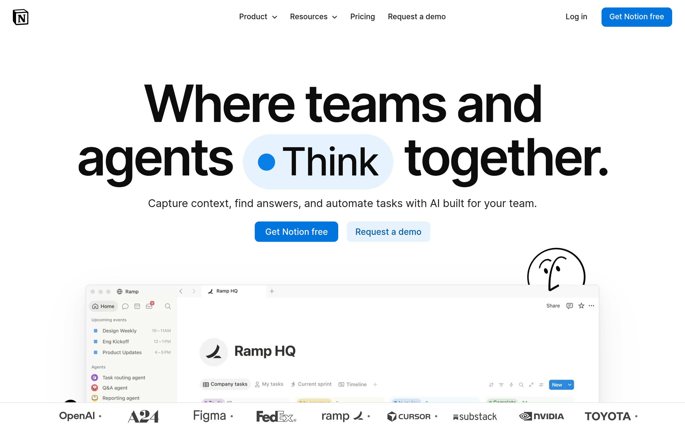

# notion DESIGN.md

> Auto-generated design system — reverse-engineered via static analysis by skillui.
> Frameworks: None detected
> Colors: 20 · Fonts: 3 · Components: 6
> Icon library: not detected · State: not detected
> Primary theme: light · Dark mode toggle: no · Motion: expressive

## Visual Reference

**Match this design exactly** — study colors, fonts, spacing, and component shapes before writing any UI code.



---

## 1. Visual Theme & Atmosphere

This is a **light-themed** interface with a cool, approachable feel. The light background emphasizes content clarity. Typography pairs **NotionInter** for display/headings with **Noto Sans Arabic** for body text, creating clear visual hierarchy through type contrast. Spacing follows a **4px base grid** (compact density), with scale: 2, 4, 6, 8, 10, 12, 14, 16px. The accent color **#0075de** anchors interactive elements (buttons, links, focus rings). Motion is expressive — spring physics, layout animations, and staggered reveals are part of the visual language.

---

## 2. Color Palette & Roles

| Token | Hex | Role | Use |
|---|---|---|---|
| tatami-color-gray-100 | `#f9f9f8` | background | Page background, darkest surface |
| tatami-color-black | `#000000` | text-primary | Headings and body text |
| tatami-color-gray-400 | `#a39e98` | text-muted | Captions, placeholders, secondary info |
| tatami-color-gray-800 | `#31302e` | border | Dividers, card borders, outlines |
| tatami-color-blue-600 | `#0075de` | accent | CTAs, links, focus rings, active states |
| tatami-color-red-200 | `#fdd3cd` | danger | Error states, destructive actions |
| tatami-color-green-500 | `#1aae39` | success | Success states, positive indicators |
| tatami-color-yellow-100 | `#fff5e0` | warning | Warning states, caution indicators |
| collection-block-background-color | `#2383e2` | info | Informational highlights |
| tatami-color-gray-900 | `#191918` | unknown | Palette color |
| tatami-color-gray-600 | `#615d59` | unknown | Palette color |
| tatami-color-blue-500 | `#097fe8` | unknown | Palette color |
| tatami-color-gray-500 | `#78736f` | unknown | Palette color |
| tatami-color-gray-300 | `#dfdcd9` | unknown | Palette color |
| tatami-color-campaigns-dev-platform-dos-blue | `#1313ba` | unknown | Palette color |
| tatami-color-campaigns-dev-platform-dos-lavender | `#cbcbef` | unknown | Palette color |
| tatami-color-blue-200 | `#e6f3fe` | unknown | Palette color |
| tatami-color-yellow-500 | `#ffb110` | unknown | Palette color |
| tatami-color-red-500 | `#f64932` | unknown | Palette color |
| tatami-color-blue-700 | `#005bab` | unknown | Palette color |

### CSS Variable Tokens

```css
--tatami-border-radius-0: 0;
--tatami-border-radius-200: .25rem;
--tatami-border-radius-300: .3125rem;
--tatami-border-radius-400: .375rem;
--tatami-border-radius-500: .5rem;
--tatami-border-radius-600: .625rem;
--tatami-border-radius-700: .75rem;
--tatami-border-radius-800: .875rem;
--tatami-border-radius-900: 1rem;
--tatami-border-radius-round: 624.938rem;
--tatami-border-width-1: var(--tatami-dimension-thickness-1);
--tatami-border-style-solid: solid;
--tatami-border-style-dashed: dashed;
--tatami-font-family-primary-sans: NotionInter;
--tatami-font-family-primary-serif: "Lyon Text";
--tatami-font-family-primary-serif-japanese: "Lyon Text";
--tatami-font-family-primary-serif-chinese-simplified: "Lyon Text";
--tatami-font-family-primary-serif-chinese-traditional: "Lyon Text";
--tatami-font-family-primary-sans-vietnamese: ui-sans-serif;
--tatami-font-family-primary-serif-vietnamese: ui-serif;
```


---

## 3. Typography Rules

**Font Stack:**
- **Noto Sans Arabic** — Heading 1, Heading 2, Heading 3
- **NotionInter** — Body, Caption
- **iA Writer Mono** — Code

**Font Sources:**

```css
@font-face {
  font-family: "NotionInter";
  src: url("fonts/NotionInter-Regular.woff2") format("woff2");
  font-weight: 400;
}
@font-face {
  font-family: "NotionInter";
  src: url("fonts/NotionInter-700.woff2") format("woff2");
  font-weight: 700;
}
@font-face {
  font-family: "Noto Sans Arabic";
  src: url("fonts/NotoSansArabic-Bold.ttf") format("truetype");
  font-weight: 700;
}
@font-face {
  font-family: "Noto Sans Arabic";
  src: url("fonts/NotoSansArabic-Regular.ttf") format("truetype");
  font-weight: 400;
}
@font-face {
  font-family: "Noto Sans Hebrew";
  src: url("fonts/NotoSansHebrew-Bold.ttf") format("truetype");
  font-weight: 700;
}
@font-face {
  font-family: "Noto Sans Hebrew";
  src: url("fonts/NotoSansHebrew-Regular.ttf") format("truetype");
  font-weight: 400;
}
@font-face {
  font-family: "Lyon Text";
  src: url("fonts/LyonText-Regular.woff2") format("woff2");
  font-weight: 400;
}
@font-face {
  font-family: "iA Writer Mono";
  src: url("fonts/iAWriterMono-Regular.woff2") format("woff2");
  font-weight: 400;
}
@font-face {
  font-family: "Permanent Marker";
  src: url("fonts/PermanentMarker-Regular.ttf") format("truetype");
  font-weight: 400;
}
```

| Role | Font | Size | Weight |
|---|---|---|---|
| Heading 1 | Noto Sans Arabic | 85px | 700 |
| Heading 2 | Noto Sans Arabic | 78px | 700 |
| Heading 3 | Noto Sans Arabic | 52px | 700 |
| Body | NotionInter | 14px | 400 |
| Caption | NotionInter | 16px | 400 |
| Code | iA Writer Mono | 14px | 400 |

**Typographic Rules:**
- Limit to 3 font families max per screen
- Use **Noto Sans Arabic** for body/UI text, **NotionInter** for display/headings
- Maintain consistent hierarchy: no more than 3-4 font sizes per screen
- Headings use bold (600-700), body uses regular (400)
- Line height: 1.5 for body text, 1.2 for headings
- Use color and opacity for secondary hierarchy, not additional font sizes


---

## 4. Component Stylings

### Layout (1)

**Footer** — `html`

### Navigation (1)

**Navigation** — `html`

### Data Input (2)

**Button** — `html`
- Animation: 

**Input** — `html`
- State: :focus, :placeholder

### Media (2)

**Image** — `html`

**Icon** — `html`


---

## 5. Layout Principles

- **Base spacing unit:** 4px
- **Spacing scale:** 2, 4, 6, 8, 10, 12, 14, 16, 18, 20, 22, 24
- **Border radius:** .25rem, .5em, 1px, 2px, 3px, 3vw, 4px, 5px, 6px, 8px, 8px 8px 0px 0px, 9px, 10px, 12px, 12px 12px 0px 0px, 16px, 20px, 24px, inherit, 30px, 32px, 38px, 58px, 100%, 100px, 200px, 999px, 1000px
- **Max content width:** 1392px

**Spacing as Meaning:**
| Spacing | Use |
|---|---|
| 4-8px | Tight: related items within a group |
| 12-16px | Medium: between groups |
| 24-32px | Wide: between sections |
| 48px+ | Vast: major section breaks |


---

## 6. Depth & Elevation

### Flat — subtle depth hints

- `0-1px #37352f17`
- `inset 0 0 0 1px #2383e291,0 0 0 2px #2383e259`
- `inset -1px 0#00000005`

### Raised — cards, buttons, interactive elements

- `var(--tatami-shadow-100)`
- `var(--mkto-form-field-focus-shadow)`
- `var(--tatami-shadow-200)`

### Floating — dropdowns, popovers, modals

- `0 3px 9px #0000,0 .7px 1.4625px #0000`
- `0 0 0 16px #2383e200`
- `0-8px 16px -8px #00000014`

### Overlay — full-screen overlays, top-level dialogs

- `0 4px 18px #0000000a,0 2.025px 7.84688px #00000007,0 .8px 2.925px #00000005,0 .175px 1.04062px #00000003`
- `0 4px 18px #0000000a,0 2.025px 7.84688px #00000007,0 .8px 2.925px #00000005,0 .175px 1.04062px #00000003,0 0 1px #fff9`
- `0 8px 24px #0f0f0f0f`

### Z-Index Scale

`0, 1, 2, 3, 4, 10, 11, 50, 99, 100, 500, 1000, 10001, 99999`


---

## 7. Animation & Motion

This project uses **expressive motion**. Animations are an integral part of the experience.

### CSS Animations

- `@keyframes fadeIn`
- `@keyframes fadeOut`
- `@keyframes scaleIn`
- `@keyframes scaleOut`
- `@keyframes popIn`
- `@keyframes rotate`
- `@keyframes HZmsMG_pulse`
- `@keyframes njy5Hq_popoverFadeIn`

### Animated Components

- **Button**: 

### Motion Guidelines

- Duration: 150-300ms for micro-interactions, 300-500ms for page transitions
- Easing: `ease-out` for enters, `ease-in` for exits
- Always respect `prefers-reduced-motion`


---

## 8. Do's and Don'ts

### Do's

- Use `#0075de` for interactive elements (buttons, links, focus rings)
- Use `#f9f9f8` as the primary page background
- Pair **Noto Sans Arabic** (body) with **NotionInter** (display) — these are the only allowed fonts
- Follow the **4px** spacing grid for all margins, padding, and gaps
- Use the defined shadow tokens for elevation — see Section 6
- Use border-radius from the scale: .25rem, .5em, 1px, 2px, 3px
- Reuse existing components from Section 4 before creating new ones

### Don'ts

- Don't introduce colors outside this palette — extend the design tokens first
- Don't introduce additional font families beyond Noto Sans Arabic and NotionInter and iA Writer Mono
- Don't use arbitrary spacing values — stick to multiples of 4px
- Don't create custom box-shadow values outside the system tokens
- Don't use arbitrary border-radius values — pick from the defined scale
- Don't duplicate component patterns — check Section 4 first
- Don't use backdrop-blur or blur effects

### Anti-Patterns (detected from codebase)

- No blur or backdrop-blur effects
- No zebra striping on tables/lists


---

## 9. Responsive Behavior

| Name | Value | Source |
|---|---|---|
| xs | 374px | css |
| xs | 375px | css |
| xs | 400px | css |
| xs | 440px | css |
| xs | 480px | css |
| sm | 500px | css |
| sm | 599px | css |
| sm | 600px | css |
| md | 668px | css |
| md | 700px | css |
| md | 712px | css |
| md | 720px | css |
| md | 740px | css |
| md | 768px | css |
| lg | 799px | css |
| lg | 839px | css |
| lg | 840px | css |
| lg | 908px | css |
| lg | 919px | css |
| lg | 942px | css |
| lg | 960px | css |
| lg | 980px | css |
| xl | 1032px | css |
| xl | 1080px | css |
| xl | 1120px | css |
| xl | 1156px | css |
| xl | 1200px | css |
| xl | 1280px | css |
| 2xl | 1300px | css |
| 2xl | 1440px | css |
| 2xl | 1600px | css |

**Approach:** Use `@media (min-width: ...)` queries matching the breakpoints above.


---

## 10. Agent Prompt Guide

Use these as starting points when building new UI:

### Build a Card

```
Background: #f9f9f8
Border: 1px solid #31302e
Radius: 12px 12px 0px 0px
Padding: 16px
Font: Noto Sans Arabic
Use shadow tokens from Section 6.
```

### Build a Button

```
Primary: bg #0075de, text white
Ghost: bg transparent, border #31302e
Padding: 8px 16px
Radius: 12px 12px 0px 0px
Hover: opacity 0.9 or lighter shade
Focus: ring with #0075de
```

### Build a Page Layout

```
Background: #f9f9f8
Max-width: 1392px, centered
Grid: 4px base
Responsive: mobile-first, breakpoints from Section 9
```

### Build a Stats Card

```
Surface: #f9f9f8
Label: #a39e98 (muted, 12px, uppercase)
Value: #000000 (primary, 24-32px, bold)
Status: use success/warning/danger from Section 2
```

### Build a Form

```
Input bg: #f9f9f8
Input border: 1px solid #31302e
Focus: border-color #0075de
Label: #a39e98 12px
Spacing: 16px between fields
Radius: 12px 12px 0px 0px
```

### General Component

```
1. Read DESIGN.md Sections 2-6 for tokens
2. Colors: only from palette
3. Font: Noto Sans Arabic, type scale from Section 3
4. Spacing: 4px grid
5. Components: match patterns from Section 4
6. Elevation: shadow tokens
```
